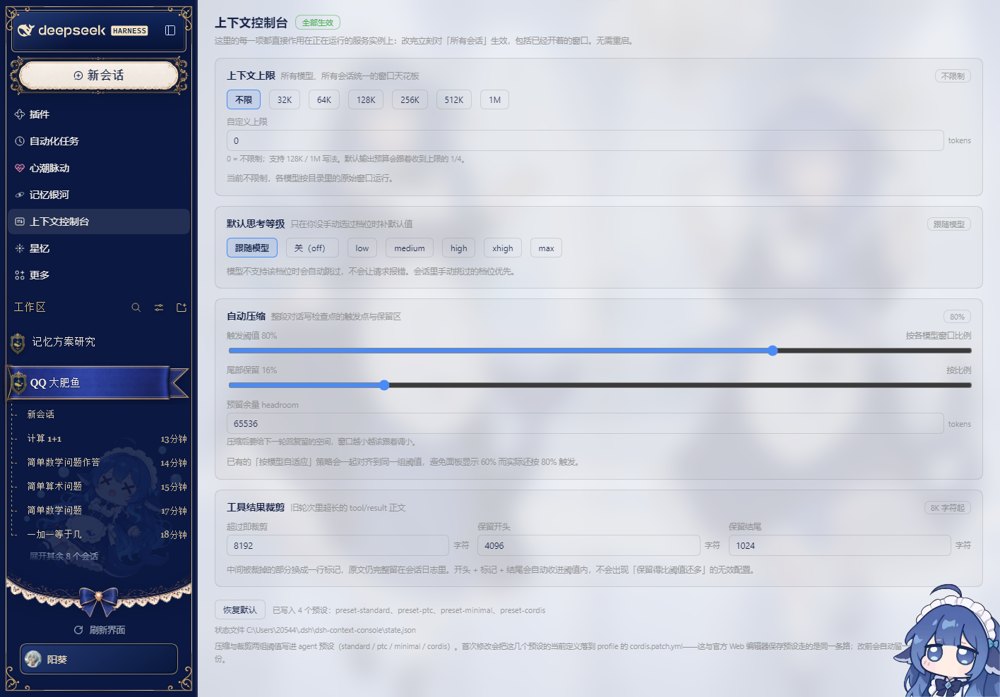

# dsh-context-console

给 [DSH](https://github.com/deepseek-ai) Web 端加一个独立面板，把**上下文上限、默认思考等级、自动压缩阈值、工具结果裁剪**这四组旋钮收进同一个地方，并且对所有会话统一生效——包括已经开着的窗口，改完立刻起作用，不用重启。



## 为什么做这个

这些参数在 DSH 里原本散落在三个互不相干的位置：模型编辑卡里能改单模型的上下文窗口，agent 预设里藏着压缩引擎的阈值，工具结果裁剪只在配置文件和插件里露面。想让它们「对所有会话统一生效」这件事，没有一个入口能做到。

这个面板就是那个入口。

## 四组能力

### 上下文上限

一条上限压在所有模型、所有会话上。设成 `128K`，目录里原本 1M 窗口的模型也会被削到 128K，面板底部会直接告诉你「20 个模型，其中 13 个会被这条上限削到」，并列出具体哪几个、从多少削到多少。

0 表示不限制（默认）。支持 `128K` / `1M` 这类写法。默认输出预算会跟着收敛到上限的 1/4，避免请求体超过窗口。

设置生效后的样子：


### 默认思考等级

`off / low / medium / high / xhigh / max`，或者「跟随模型」保持原样。

只在你没在会话里手动选过档位时补默认值；模型不支持该档位时会自动跳过，不会让请求报错。

### 自动压缩

- **触发阈值**：上下文用到窗口的百分之多少时开始写检查点（30%–98%）
- **尾部保留**：最近多少比例的原文原样留着（0% – 阈值-2%）
- **预留余量 headroom**：给模型回复留的空间，太小会频繁压缩

保留区永远被压在触发阈值之下——否则压缩引擎每次调用都会抛错。

### 工具结果裁剪

超过阈值的 `tool/result` 正文会被折成一行标记，原文仍然留在会话日志里，随时可以展开回看。

三个数字互相约束：`开头 + 标记 + 结尾` 必须装进 `阈值`，所以面板会在你调大开头/结尾时同步把阈值抬上去，不会产生「保留得比阈值还多」这种无效配置。

## 安装

前提：DSH Web 端跑在本地，profile 在 `~/.dsh/profiles/web`。

1. 把本目录放到任意位置（例如 `~/dsh-plugins-src/dsh-context-console`），在 `~/.dsh/profiles/web/package.json` 的 `dependencies` 里加一行：

```json
"dsh-context-console": "link:C:/Users/you/dsh-plugins-src/dsh-context-console"
```

2. 在 `~/.dsh/profiles/web/cordis.patch.yml` 末尾加：

```yaml
- insert:
    - id: context-console
      name: dsh-context-console
```

3. 在 profile 目录执行 `pnpm install`，然后重启 `dsh web`。

左侧栏会出现「上下文控制台」入口。

## 实现原理

三处挂载点，都不需要改 dsh 本体：

**模型窗口**：包一层 `llm.normalizeModelInfo`。

```js
llm.normalizeModelInfo = function patched(registration, model, resolved) {
  return clampInfo(originalNormalize.call(this, registration, model, resolved))
}
```

只包这一个函数是有原因的：`resolveModelInfo` 内部会再调 `resolveModelInfoFor`，如果在多个层级同时包，后一层会把前一层钳过的值当成「原始值」，面板上就再也读不出真实窗口了。`normalizeModelInfo` 是所有路径的汇聚点。

**默认思考等级**：包 `llm.resolveCallWithInfo`，在调用前补 `profile.reasoning`，模型不支持该档位就原样放过。

**压缩 / 裁剪**：这两个服务是**预设级隔离实例**（`presets/*.patch.yml` 里 `isolate: { compaction: true, toolResultPruner: true }`），每个 agent 各起一份，宿主侧 `ctx.get('compaction')` 永远是 `undefined`。所以改不了运行中的实例，只能写配置——通过 `configEditor.edit()` 把值落进 profile 的 agent 预设。

## 一件必须知道的事

写预设用的是 profile 的 `plugins` 字段，而它是**整体替换**而非按 id 合并。实测只交 `compaction` 一组，预设会被削成 1 行（persona、tools 全丢）。

所以本插件每次都交完整快照，只改 `compaction` 组里的两条子行。并且：

- 写入前对比，值已一致就跳过，不产生任何写操作
- 首次写入会留备份 `cordis.patch.yml.bak-console-<时间戳>`
- 启动时只做只读对齐（统计匹配数喂给报告），只有 `state.json` 真的读到了、且与 profile 漂移时才落盘——避免状态文件丢失时用默认值覆盖你已生效的配置

## 状态文件

```json
~/.dsh/dsh-context-console/state.json
```

- 上下文上限与思考等级：立刻对运行中的实例生效
- 压缩与裁剪：写进 4 个 agent 预设，对新会话生效；已开着的会话沿用启动时那份实例配置

## 接口

面板走的是普通 HTTP，都可以用 `curl` 直接调：

| 方法 | 路径 | 作用 |
| --- | --- | --- |
| GET | `/context-console/api/state` | 当前配置、生效报告、模型清单 |
| POST | `/context-console/api/apply` | 写入配置并立即生效 |
| POST | `/context-console/api/reset` | 回到出厂值 |
| GET | `/context-console/api/probe` | 自检：目录声明窗口 vs 实际返回窗口 |

## 已知边界

- 压缩 / 裁剪是预设级配置，改了之后**已有会话**仍用旧值，新会话才吃新配置。
- 上下文上限是硬钳制，不会因为你选了更大的模型而放宽——这条上限优先。
- 面板 UI 是手写 `React.createElement`，没有构建步骤，改完刷新即可见效。

## License

MIT
